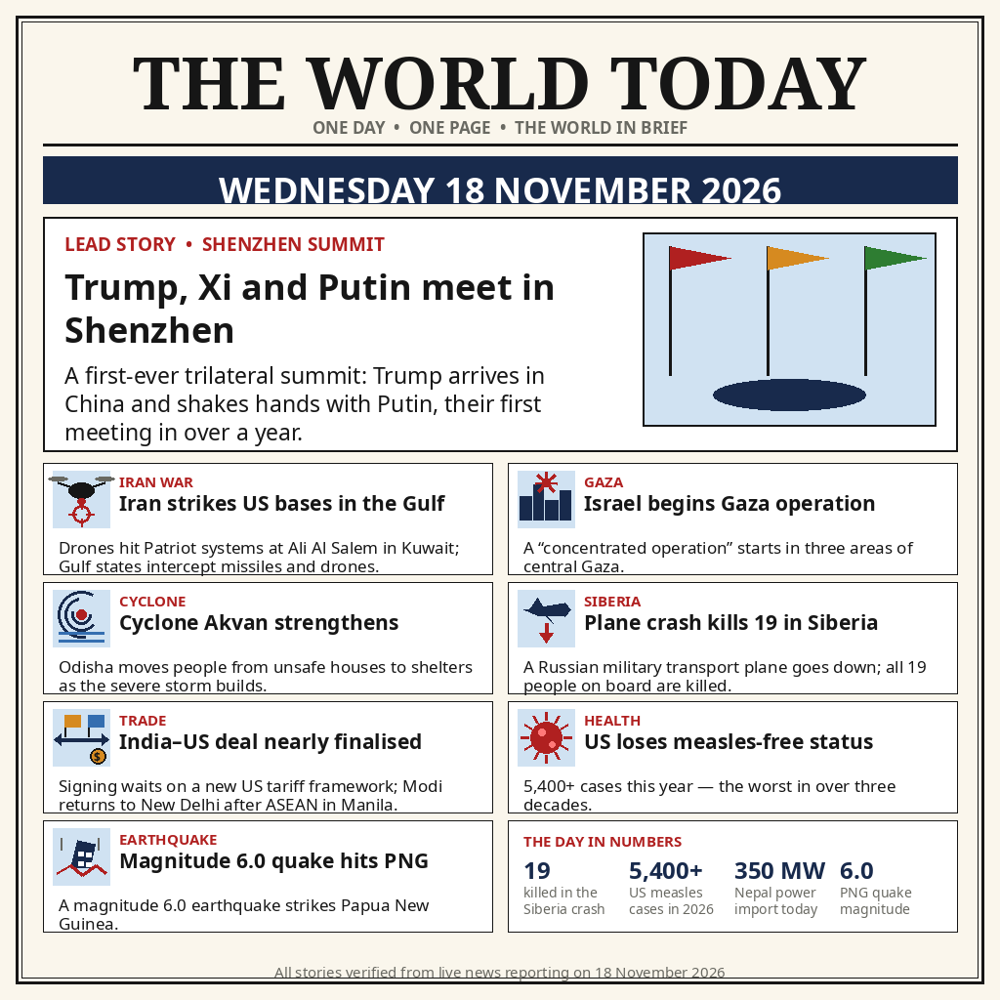

# The World Today — Wednesday 18 November 2026

[](https://make.fun/bounty/news-image-20261118)
[](https://make.fun/bounty/news-image-20261118)
[](https://make.fun/bounty/news-image-20261118)

A 1024×1024 newspaper-front-page infographic summing up Wednesday
18 November 2026 in one image — my entry for the
[news-image-20261118](https://make.fun/bounty/news-image-20261118)
competition on make.fun ($250, free entry).



## The stories

Every story on the page is a real event verified from live news reporting
on 18 November 2026 — nothing invented, nothing shown as fact that was not
reported that day.

**Lead story — the Shenzhen summit.** Donald Trump arrives in Shenzhen,
China for a first-ever trilateral summit with Xi Jinping and Vladimir
Putin. Trump and Putin shake hands — their first meeting in over a year.

**The other stories:**

- **Iran war** — Iran launches drone strikes on US bases: drones strike
  Patriot air-defence systems at Ali Al Salem Air Base in Kuwait, and
  Gulf states intercept Iranian missiles and drones. This follows the US
  striking Qeshm Island in the Strait of Hormuz.
- **Gaza** — Israel begins a "concentrated operation" in three areas of
  central Gaza.
- **Cyclone Akvan** — the cyclone strengthens into a severe cyclonic
  storm; Odisha moves people from unsafe houses to shelters.
- **Siberia** — a Russian military transport plane crashes in Siberia,
  killing all 19 people on board.
- **India–US trade** — the India–US trade deal is nearly finalised, with
  signing delayed pending a new US tariff framework; PM Modi returns to
  New Delhi after the ASEAN summit in Manila.
- **Measles** — the US loses its measles-free status, with 5,400+ cases
  reported this year, the worst in over three decades.
- **Papua New Guinea** — a magnitude 6.0 earthquake strikes.

**The day in numbers** — 19 killed in the Siberia crash; 5,400+ US
measles cases in 2026; 350 MW of Nepal power imported today; magnitude
6.0 for the Papua New Guinea quake.

## How it is made

`draw.py` (Python 3 + Pillow only) draws the whole page: a serif
masthead ("THE WORLD TODAY"), a navy date band, the lead story with a
flat vector-style pictogram of three summit flags over a round table,
seven more stories each with a short headline, a one-line summary and a
small hand-drawn pictogram (drone, skyline, cyclone spiral, jet,
trade flags, virus, cracked ground), and a "day in numbers" box.

The drawing is fully deterministic — fixed content, no timestamps, no
randomness — so running `draw.py` twice produces byte-identical
`entry.png`.

`main.ts` (Node 22, standard library only) copies `entry.png` into the
output directory (`MAKEFUN_OUTPUT_DIR`, or `/output` by default).

## Reproduce

```sh
# 1. Draw the front page (writes entry.png, 1024x1024, under 1 MiB)
python3 draw.py

# 2. Check determinism: two runs must give the same sha256
python3 draw.py && sha256sum entry.png
python3 draw.py && sha256sum entry.png

# 3. Copy it to the output directory
mkdir -p out && MAKEFUN_OUTPUT_DIR=out node main.ts
cmp out/entry.png entry.png   # byte-identical
```

## License

MIT — see [LICENSE](LICENSE).
